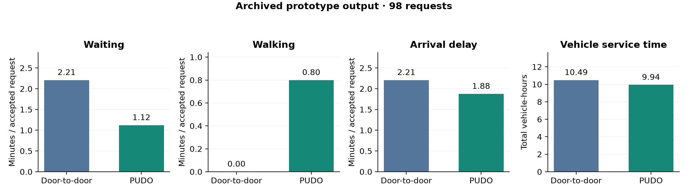
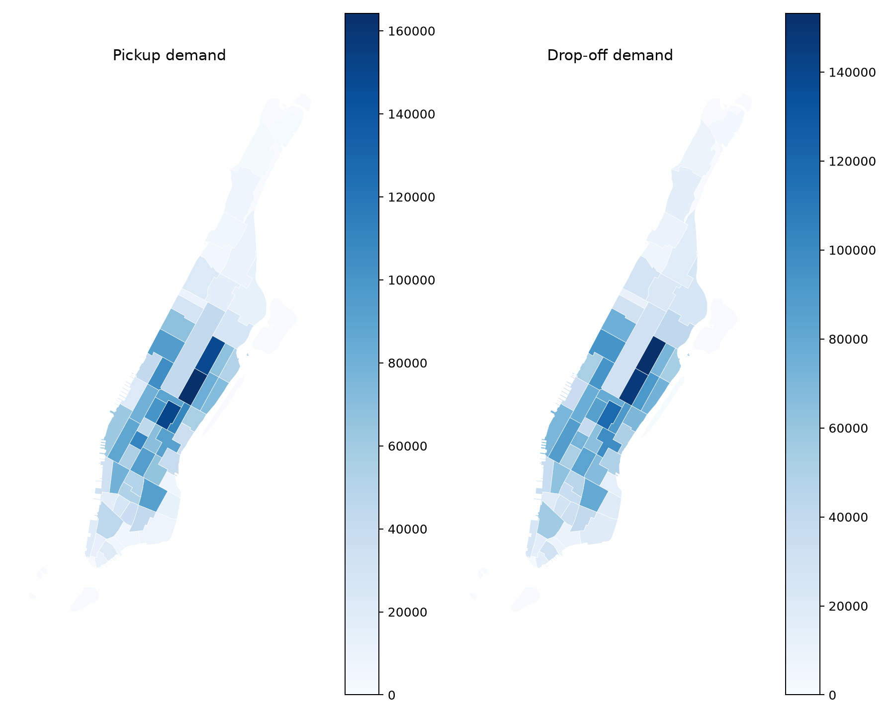
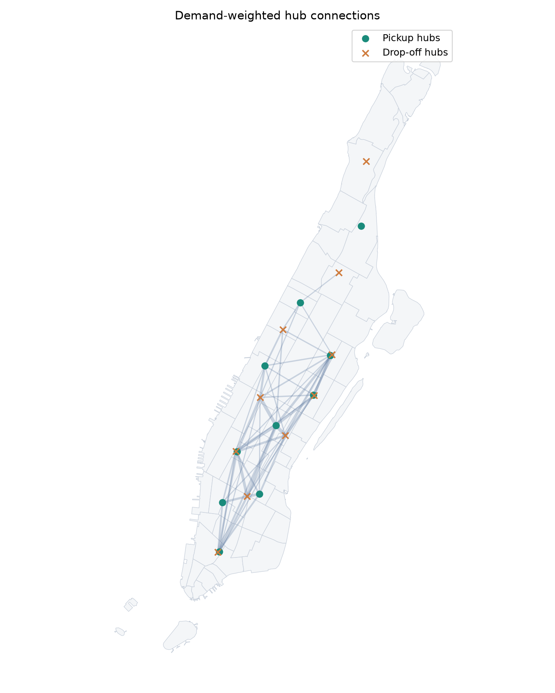

# NYC Ridesharing & PUDO Study

Two independent learning experiments using NYC taxi demand and Manhattan geography: dynamic ridesharing with flexible pickup/drop-off locations, and demand-weighted hub exploration.

**Status:** an evolving personal research practice archive. The assignment comparison below is historical output; the hub analysis has been rerun with the cleaned implementation. These experiments do not constitute a validated reproduction or an operational service design.

## Experiments

| Experiment | Question | Entry point | Evidence |
| --- | --- | --- | --- |
| Dynamic assignment · Practice 1 | How might short walks to alternative pickup/drop-off locations affect ridesharing? | [`src/dynamic_assignment.py`](src/dynamic_assignment.py) | Preserved 98-request comparison; offline regression tests for the corrected implementation |
| Demand hubs · Practice 2 | Where does Manhattan taxi demand concentrate, and which hub pairs carry the most demand? | [`src/hub_analysis.py`](src/hub_analysis.py) | Fresh March 2026 analysis of 3,051,915 filtered trips |

PUDO means **pickup and drop-off**. The experiments share a data context but do not depend on each other. Hub locations are not inputs to the dynamic assignment model.

## Practice 1 · Flexible pickup and drop-off

The prototype batches requests, enumerates feasible request groups and service sequences, evaluates group–vehicle costs, and solves a binary assignment problem. It compares door-to-door service with short walks to nearby network nodes.



| Metric | Door-to-door | PUDO with walking |
| --- | ---: | ---: |
| Accepted / requested | 98 / 98 | 98 / 98 |
| Mean waiting time, min | 2.21 | 1.12 |
| Mean total walking time, min | 0.00 | 0.80 |
| Mean arrival delay, min | 2.21 | 1.88 |
| Total vehicle service time, h | 10.49 | 9.94 |

These numbers describe **one archived prototype output**, not results regenerated by the corrected code. The historical fleet size, request window, and network snapshot were not recorded. Waiting excludes the origin walk; walking includes both ends. Vehicle service time includes driving and waiting for passenger readiness. See [model and metric details](docs/dynamic-assignment.md) before interpreting the comparison.

## Practice 2 · Demand-weighted hubs

The cleaned implementation aggregates Manhattan-to-Manhattan yellow taxi trips, clusters taxi-zone centroids into 10 pickup and 10 drop-off hubs using demand weights, and ranks hub pairs by trip count.

The fresh March 2026 run retained **3,051,915 trips**. Its 50 highest-demand hub pairs account for **85.98%** of retained trips. This is a demand concentration statistic; it does not measure fleet efficiency or service quality.

<p align="center">
  
  
</p>

Connections in the second map are straight lines between statistical centers, not road routes. The repository also preserves an [older road-route visualization](figures/archived/manhattan_hub_road_routes.png), which belongs to the original clustering run. See [hub methods, outputs, and limitations](docs/hub-analysis.md).

## Run locally

Use Python 3.12 or newer. Dependencies were checked with Python 3.14; the tested package versions are listed in [validation notes](docs/validation.md).

```bash
python3 -m venv .venv
source .venv/bin/activate
python -m pip install -r requirements.txt
```

Download the inputs and arrange them as described in [DATA.md](DATA.md). Raw taxi records, shapefiles, and OSM caches are excluded from this repository.

Run the hub analysis without network access after preparing the data:

```bash
python src/hub_analysis.py
```

To add routes on an existing OSMnx GraphML snapshot, use `--graph-file path/to/road-network.graphml`. Alternatively, `--road-network` downloads a Manhattan drive graph from OpenStreetMap. Online downloads depend on external services and may take time.

Run a small dynamic comparison:

```bash
python src/dynamic_assignment.py   --max-requests 100 --n-vehicles 50 --max-group-size 2   --candidate-limit 3 --mode compare   --save-graph data/raw/manhattan-drive.graphml
```

The first run downloads a drive network unless `--graph-file` is provided. Both scenarios use the same sampled requests and initial fleet. The example is a new exploratory run, not a reconstruction of the archived 98-request output. Enumeration grows rapidly with group size and candidate count.

Run offline checks and regenerate the archived figure:

```bash
python -m unittest discover -s tests -v
python scripts/validate_archive.py
python scripts/plot_archived.py
```

## Repository layout

```text
src/                         Cleaned English implementations
archive/                     Unmodified original Practice 1 and Practice 2 scripts
results/hub_analysis/        Fresh hub-analysis CSVs, figures, and run manifest
results/archived/            Preserved historical CSVs and provenance hashes
figures/                    Archived comparison figure and original maps
docs/                       Methods, limitations, and validation notes
scripts/                    Figure generation and archive checks
tests/                      Small offline model regression tests
data/raw/                   Local inputs; intentionally not committed
```

The original source snapshots retain their original comments. The maintained scripts and project documentation are in English. The delivery demo is outside the scope of this repository.

## Data and research references

- [NYC TLC Trip Record Data](https://www.nyc.gov/site/tlc/about/tlc-trip-record-data.page): yellow taxi records, taxi-zone lookup, and zone boundaries.
- [Yellow Taxi Trip Records Data Dictionary](https://www.nyc.gov/assets/tlc/downloads/pdf/data_dictionary_trip_records_yellow.pdf): field definitions.
- [OpenStreetMap contributors](https://www.openstreetmap.org/copyright): road-network data; applicable ODbL attribution and terms remain with the data.
- Fielbaum, A., Bai, X., & Alonso-Mora, J. (2021). [On-demand ridesharing with optimized pick-up and drop-off walking locations](https://doi.org/10.1016/j.trc.2021.103061). *Transportation Research Part C*, 126, 103061. Inspiration for the assignment exercise; no claim of full reproduction.
